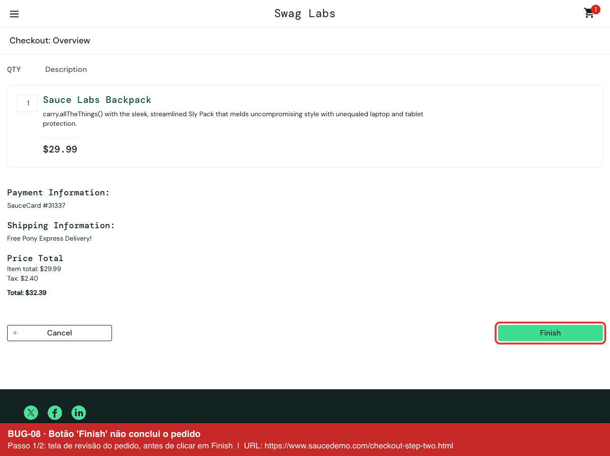

🇧🇷 [Português](README.md) | 🇺🇸 English

# SauceDemo — Automated tests (Selenium + Pytest) and exploratory testing

QA study project on the demo website **[SauceDemo](https://www.saucedemo.com/)** (Swag Labs), an online store built for testing practice.

## 📝 Project description

The project has two parts:

1. **Automated E2E (end-to-end) tests:** 13 tests with Selenium WebDriver and Pytest. They cover login, cart, product sorting, checkout and logout with the standard user (`standard_user`).
2. **Exploratory testing:** manual testing with the test users `problem_user`, `error_user` and `visual_user`. I found **10 bugs**. Each one has evidence (screenshot or screen recording) and is logged in **Jira** with steps to reproduce, expected result, actual result and priority.

## 🎯 1. Project goal

- Validate the main flows of an online store: login, cart, sorting and purchase.
- Practice web test automation with an organized, easy-to-maintain structure (Page Object Model).
- Find, document and report bugs as in a real QA team.

## ✅ 2. Results

- **13 automated tests, all passing**, with `standard_user` (about 50 s).
- **10 bugs found** in exploratory testing, with evidence in the [`evidencias/`](evidencias/) folder and logged in Jira (SD project).

### 🧪 Automated tests

| File | Test | What it checks |
|---|---|---|
| `test_login.py` | `test_login_with_valid_user` | Login with a valid user opens the products page |
| | `test_login_with_locked_out_user` | Locked-out user sees an error message |
| | `test_login_with_wrong_password` | Wrong password shows an error |
| | `test_login_with_empty_username` | Empty username shows "Username is required" |
| `test_inventory.py` | `test_add_one_item_updates_cart_badge` | Adding 1 item shows "1" on the cart |
| | `test_add_two_items_updates_cart_badge` | Adding 2 items shows "2" on the cart |
| | `test_remove_item_clears_cart_badge` | Removing the item clears the counter |
| | `test_sort_by_price_low_to_high` | Sorting by price, low to high |
| | `test_sort_by_price_high_to_low` | Sorting by price, high to low |
| `test_checkout.py` | `test_complete_purchase` | Full purchase up to "Thank you for your order!" |
| | `test_checkout_without_first_name` | Checkout without a first name shows an error |
| | `test_checkout_without_postal_code` | Checkout without a postal code shows an error |
| | `test_logout_returns_to_login_page` | Logout returns to the login page |

### 🐞 Bugs found

| ID | User | Bug | Priority | Evidence |
|---|---|---|---|---|
| BUG-01 | problem_user | All product images are the same | Low | [screenshot](evidencias/BUG-01_problem-user_imagens-dos-produtos-todas-iguais.png) |
| BUG-02 | problem_user | Sorting by price does not work | Medium | [recording](evidencias/BUG-02_problem-user_ordenacao-por-preco-nao-funciona.gif) |
| BUG-03 | problem_user | "Add to cart" button does not add some items | High | [recording](evidencias/BUG-03_problem-user_botao-add-to-cart-nao-adiciona-item.gif) |
| BUG-04 | problem_user | "Remove" button does not remove the item | High | [recording](evidencias/BUG-04_problem-user_botao-remove-nao-remove-item.gif) |
| BUG-05 | problem_user | At checkout, the last name replaces the first name | High | [recording](evidencias/BUG-05_problem-user_checkout-sobrenome-substitui-nome.gif) |
| BUG-06 | error_user | Sorting shows an error alert and does not sort | Medium | [screenshot](evidencias/BUG-06_error-user_ordenacao-exibe-alerta-de-erro.png) |
| BUG-07 | error_user | Last name does not accept text and checkout proceeds without validation | High | [recording](evidencias/BUG-07_error-user_sobrenome-nao-aceita-texto-e-checkout-avanca.gif) |
| BUG-08 | error_user | "Finish" button does not complete the order | Critical | [recording](evidencias/BUG-08_error-user_botao-finish-nao-conclui-pedido.gif) |
| BUG-09 | visual_user | Wrong prices that change on every page load | High | [recording](evidencias/BUG-09_visual-user_precos-incorretos-mudam-a-cada-carregamento.gif) |
| BUG-10 | visual_user | Wrong backpack image | Low | [screenshot](evidencias/BUG-10_visual-user_imagem-da-mochila-incorreta.png) |

The full reports are in [`BUGS_PARA_JIRA.md`](BUGS_PARA_JIRA.md) (in Portuguese). Each one includes precondition, steps, expected result and actual result.



## 🛠️ 3. Tools used

- **Python 3.13**
- **Selenium WebDriver 4**: Chrome browser automation
- **Pytest**: test execution and fixtures
- **Page Object Model (POM)**: page organization
- **WebDriverWait**: explicit waits
- **Jira**: bug logging and tracking
- **Pillow**: creating the evidence recordings (GIF)
- **Git and GitHub**: version control

## 📚 4. What I learned

- Structuring an automation project with the **Page Object Model**, separating pages, data and tests.
- Using **explicit waits** instead of fixed pauses. This avoids flaky tests, such as the logout test, which failed by checking the screen too early.
- Creating **Pytest fixtures** to open the browser and log in before each test.
- Using stable selectors (`data-test`) to locate elements.
- Doing **exploratory testing** with different user profiles and seeing that the same flow can fail in different ways.
- **Writing good bug reports** with a clear title, steps to reproduce, expected and actual results, priority and evidence.
- Deciding when to use a **screenshot** (error visible on a single screen) and when to use a **recording** (error that depends on an action).

## 🚀 5. Future improvements

- Automate the 10 bugs found as tests that run with the other users (`problem_user`, `error_user`, `visual_user`).
- Parameterize the tests with `@pytest.mark.parametrize` to run the same scenario with several users.
- Generate an HTML report with `pytest-html` or Allure.
- Run the tests on **GitHub Actions** (CI) in headless mode on every push.
- Test on other browsers, such as Firefox and Edge.

## 🔬 Methodology

1. **Analysis:** explored the website and mapped the main flows (login → products → cart → checkout → logout).
2. **Test cases:** defined positive scenarios (full purchase) and negative ones (wrong password, empty required fields, locked-out user).
3. **Automation:** implemented the cases with Selenium and Pytest using the Page Object Model and explicit waits.
4. **Exploratory testing:** repeated the flows with the problem users and compared them with `standard_user`.
5. **Reporting:** documented each bug with evidence and logged it in Jira with a priority.

## 📁 Structure

```
saucedemo-selenium-pytest/
├── conftest.py          # fixtures: opens Chrome and logs in
├── data.py              # URL and test data
├── pages/               # Page Objects
│   ├── base_page.py     # common actions + explicit waits
│   ├── login_page.py
│   ├── inventory_page.py
│   └── checkout_page.py
├── tests/               # tests organized by feature
│   ├── test_login.py
│   ├── test_inventory.py
│   └── test_checkout.py
├── evidencias/          # bug screenshots and recordings
├── scripts/             # scripts that generate the evidence
└── BUGS_PARA_JIRA.md    # full bug reports (in Portuguese)
```

## ▶️ How to run

1. Create and activate the virtual environment:
   ```
   python3 -m venv .venv
   source .venv/bin/activate
   ```
2. Install the dependencies:
   ```
   pip install -r requirements.txt
   ```
3. Run all tests:
   ```
   pytest -v
   ```
   To run a single file: `pytest tests/test_login.py -v`

## 👩‍💻 Author

Scheila Schwede Wink — [LinkedIn](https://www.linkedin.com/in/scheila-schwede-wink/) · [GitHub](https://github.com/scheilaswink)
