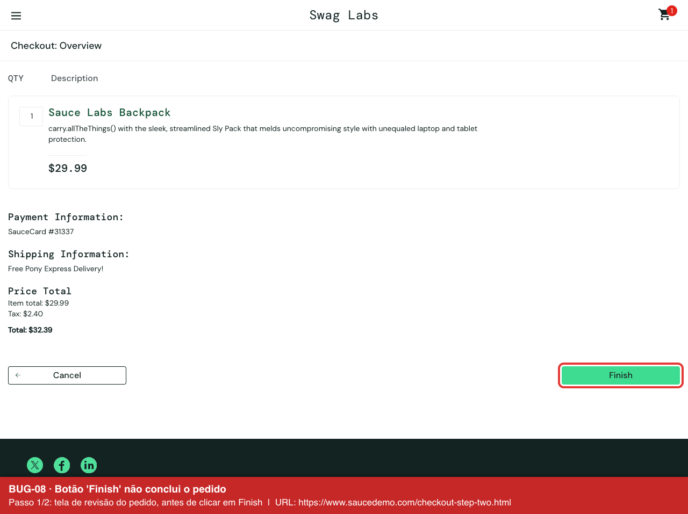

# SauceDemo — Testes automatizados (Selenium + Pytest) e testes exploratórios

Projeto de estudo em QA no site de demonstração **[SauceDemo](https://www.saucedemo.com/)** (Swag Labs), uma loja virtual criada para treino de testes.

## 📝 Descrição do projeto

O projeto tem duas partes:

1. **Testes automatizados E2E (ponta a ponta):** 13 testes com Selenium WebDriver e Pytest. Eles cobrem login, carrinho, ordenação de produtos, checkout e logout com o usuário padrão (`standard_user`).
2. **Testes exploratórios:** testes manuais com os usuários de teste `problem_user`, `error_user` e `visual_user`. Encontrei **10 bugs**. Cada um tem evidência (print ou gravação) e está registrado no **Jira** com passos para reproduzir, resultado esperado, resultado obtido e prioridade.

## 🎯 1. Objetivo do projeto

- Validar os fluxos principais de uma loja virtual: login, carrinho, ordenação e compra.
- Praticar automação de testes web com uma estrutura organizada e fácil de manter (Page Object Model).
- Encontrar, documentar e reportar bugs como em um time de QA real.

## ✅ 2. Resultado

- **13 testes automatizados, todos passando**, com o `standard_user` (cerca de 50 s).
- **10 bugs encontrados** nos testes exploratórios, com evidências na pasta [`evidencias/`](evidencias/) e registrados no Jira (projeto SD).

### 🧪 Testes automatizados

| Arquivo | Teste | O que valida |
|---|---|---|
| `test_login.py` | `test_login_with_valid_user` | Login com usuário válido abre a página de produtos |
| | `test_login_with_locked_out_user` | Usuário bloqueado vê mensagem de erro |
| | `test_login_with_wrong_password` | Senha incorreta exibe erro |
| | `test_login_with_empty_username` | Usuário vazio exibe "Username is required" |
| `test_inventory.py` | `test_add_one_item_updates_cart_badge` | Adicionar 1 item mostra "1" no carrinho |
| | `test_add_two_items_updates_cart_badge` | Adicionar 2 itens mostra "2" no carrinho |
| | `test_remove_item_clears_cart_badge` | Remover item zera o contador |
| | `test_sort_by_price_low_to_high` | Ordenação por preço crescente |
| | `test_sort_by_price_high_to_low` | Ordenação por preço decrescente |
| `test_checkout.py` | `test_complete_purchase` | Compra completa até "Thank you for your order!" |
| | `test_checkout_without_first_name` | Checkout sem nome exibe erro |
| | `test_checkout_without_postal_code` | Checkout sem CEP exibe erro |
| | `test_logout_returns_to_login_page` | Logout volta para a tela de login |

### 🐞 Bugs encontrados

| ID | Usuário | Bug | Prioridade | Evidência |
|---|---|---|---|---|
| BUG-01 | problem_user | Imagens dos produtos são todas iguais | Baixa | [print](evidencias/BUG-01_problem-user_imagens-dos-produtos-todas-iguais.png) |
| BUG-02 | problem_user | Ordenação por preço não funciona | Média | [gravação](evidencias/BUG-02_problem-user_ordenacao-por-preco-nao-funciona.gif) |
| BUG-03 | problem_user | Botão "Add to cart" não adiciona alguns itens | Alta | [gravação](evidencias/BUG-03_problem-user_botao-add-to-cart-nao-adiciona-item.gif) |
| BUG-04 | problem_user | Botão "Remove" não remove o item | Alta | [gravação](evidencias/BUG-04_problem-user_botao-remove-nao-remove-item.gif) |
| BUG-05 | problem_user | No checkout, o sobrenome substitui o nome | Alta | [gravação](evidencias/BUG-05_problem-user_checkout-sobrenome-substitui-nome.gif) |
| BUG-06 | error_user | Ordenação exibe alerta de erro e não ordena | Média | [print](evidencias/BUG-06_error-user_ordenacao-exibe-alerta-de-erro.png) |
| BUG-07 | error_user | Sobrenome não aceita texto e o checkout avança sem validação | Alta | [gravação](evidencias/BUG-07_error-user_sobrenome-nao-aceita-texto-e-checkout-avanca.gif) |
| BUG-08 | error_user | Botão "Finish" não conclui o pedido | Crítica | [gravação](evidencias/BUG-08_error-user_botao-finish-nao-conclui-pedido.gif) |
| BUG-09 | visual_user | Preços incorretos que mudam a cada carregamento | Alta | [gravação](evidencias/BUG-09_visual-user_precos-incorretos-mudam-a-cada-carregamento.gif) |
| BUG-10 | visual_user | Imagem da mochila incorreta | Baixa | [print](evidencias/BUG-10_visual-user_imagem-da-mochila-incorreta.png) |

Os relatórios completos estão em [`BUGS_PARA_JIRA.md`](BUGS_PARA_JIRA.md). Cada um traz pré-condição, passos, resultado esperado e resultado obtido.



## 🛠️ 3. Ferramentas utilizadas

- **Python 3.13**
- **Selenium WebDriver 4**: automação do navegador Chrome
- **Pytest**: execução dos testes e fixtures
- **Page Object Model (POM)**: organização das páginas
- **WebDriverWait**: esperas explícitas
- **Jira**: registro e acompanhamento dos bugs
- **Pillow**: geração das gravações (GIF) das evidências
- **Git e GitHub**: versionamento

## 📚 4. O que aprendi

- Estruturar um projeto de automação com **Page Object Model**, separando páginas, dados e testes.
- Usar **esperas explícitas** em vez de pausas fixas. Isso evita testes instáveis, como no logout, que falhava ao checar a tela cedo demais.
- Criar **fixtures no Pytest** para abrir o navegador e fazer login antes de cada teste.
- Usar seletores estáveis (`data-test`) para localizar elementos.
- Fazer **testes exploratórios** com perfis de usuário diferentes e perceber que um mesmo fluxo pode falhar de formas diferentes.
- **Escrever bons relatórios de bug** com título claro, passos para reproduzir, resultado esperado e obtido, prioridade e evidência.
- Decidir quando usar **print** (erro visível em uma tela) e quando usar **gravação** (erro que depende de uma ação).

## 🚀 5. Melhorias futuras

- Automatizar os 10 bugs encontrados como testes que rodam com os outros usuários (`problem_user`, `error_user`, `visual_user`).
- Parametrizar os testes com `@pytest.mark.parametrize` para rodar o mesmo cenário com vários usuários.
- Gerar relatório em HTML com `pytest-html` ou Allure.
- Rodar os testes no **GitHub Actions** (CI) em modo headless a cada push.
- Testar em outros navegadores, como Firefox e Edge.

## 🔬 Metodologia

1. **Análise:** explorei o site e mapeei os fluxos principais (login → produtos → carrinho → checkout → logout).
2. **Casos de teste:** defini cenários positivos (compra completa) e negativos (senha errada, campos obrigatórios vazios, usuário bloqueado).
3. **Automação:** implementei os casos com Selenium e Pytest usando Page Object Model e esperas explícitas.
4. **Testes exploratórios:** repeti os fluxos com os usuários com problemas e comparei com o `standard_user`.
5. **Registro:** documentei cada bug com evidência e o cadastrei no Jira com prioridade.

## 📁 Estrutura

```
saucedemo-selenium-pytest/
├── conftest.py          # fixtures: abre o Chrome e faz login
├── data.py              # URL e dados de teste
├── pages/               # Page Objects
│   ├── base_page.py     # ações comuns + esperas explícitas
│   ├── login_page.py
│   ├── inventory_page.py
│   └── checkout_page.py
├── tests/               # testes organizados por funcionalidade
│   ├── test_login.py
│   ├── test_inventory.py
│   └── test_checkout.py
├── evidencias/          # prints e gravações dos bugs
├── scripts/             # scripts que geram as evidências
└── BUGS_PARA_JIRA.md    # relatórios completos dos bugs
```

## ▶️ Como executar

1. Crie e ative o ambiente virtual:
   ```
   python3 -m venv .venv
   source .venv/bin/activate
   ```
2. Instale as dependências:
   ```
   pip install -r requirements.txt
   ```
3. Rode todos os testes:
   ```
   pytest -v
   ```
   Para rodar só um arquivo: `pytest tests/test_login.py -v`

## 👩‍💻 Autora

Scheila Schwede Wink — [LinkedIn](https://www.linkedin.com/in/scheila-schwede-wink/) · [GitHub](https://github.com/scheilaswink)
